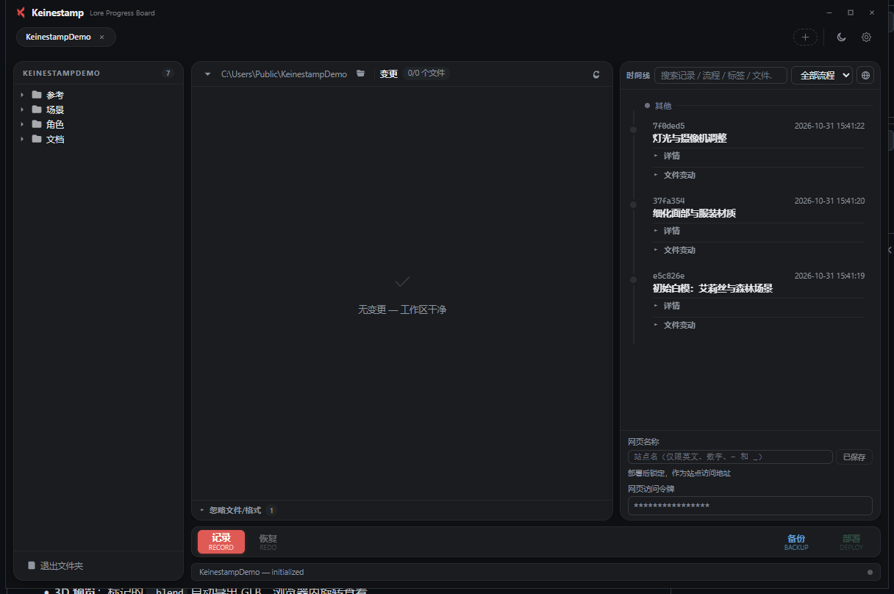
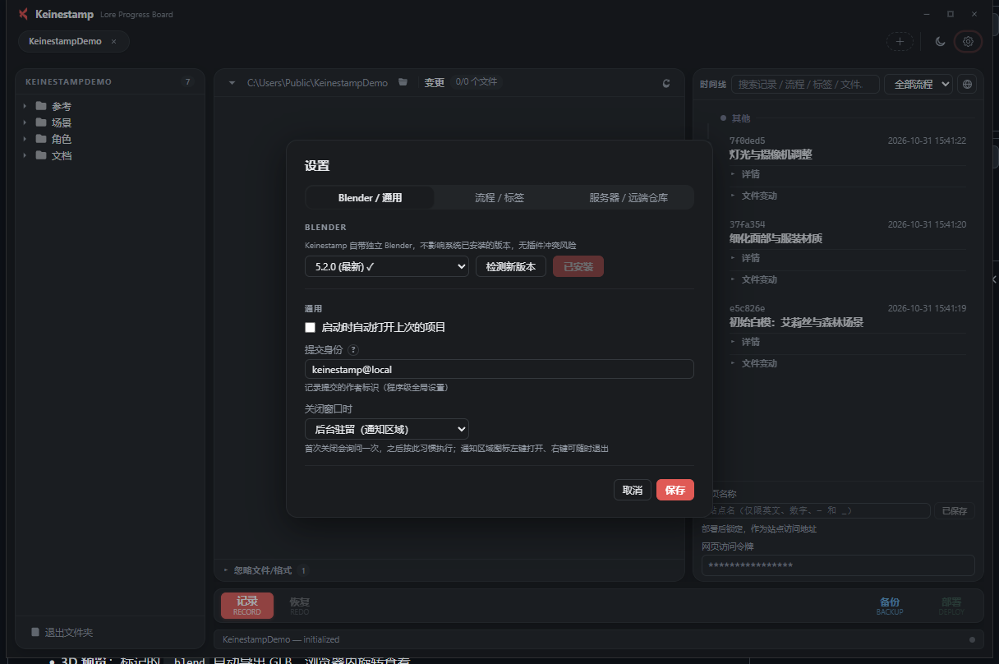

# Keinestamp

**Blender 项目进度看板** —— 本地优先的记录 / 回退 / 局域网备份 / 网页时间线部署。

后端使用 [Epic Games Lore](https://github.com/EpicGames/lore) 0.8.6（内容寻址、分块去重 VCS），
大 `.blend` 反复保存不会撑大仓库。GUI（Tauri 2 + Svelte 5）与 CLI 共用同一套后端逻辑，
纯本地离线可用，备份与网页部署按需开启。



## 功能

- **一键记录**：勾选变更文件 → 记录推进；支持流程分类、标签、3D 预览标记
- **时间线**：搜索 / 按流程筛选、里程碑、文件变动、与上一记录对比
- **回退 / 恢复 / 顶替**：选择任意记录回退（工作区落到其父版本并检出该记录改动），可撤销回退；回退后继续记录即顶替
- **去重存储**：Lore 分块去重，`.blend` 连存 10 次仓库增量 < 1%（实测 99.9% 去重）
- **3D 预览**：标记的 `.blend` 自动导出 GLB，浏览器内旋转查看
- **局域网备份**：`备份` = `lore push` 到 loreserver；离线仓库可一键迁移为在线
- **网页时间线**：多租户 `serve` 一键部署到自建服务器；令牌登录、深浅主题、移动端可用
- **Blender 版本管理**：列出官方版本、下载安装、切换当前使用版本

## 快速开始（Windows）

| 方式 | 说明 |
|---|---|
| 安装包 | 下载 `Keinestamp_0.5.0_x64-setup.exe` 安装 |
| 便携版 | 下载 `Keinestamp-0.5.0-windows-x64-portable.zip`，解压到任意目录运行 `Keinestamp.exe` |

> 便携版 = `Keinestamp.exe` + 同目录 `lore-bin/`（`lore.exe`、`loreserver.exe`、`LICENSE`）。
> 启动时校验捆绑的 Lore 版本必须为 `0.8.6`。

1. 启动后点「+ 新建项目」，选择 Blender 项目目录（或已含 `.blend` 的目录）
2. 在左侧「变更」面板勾选要纳入本次记录的文件，点右上「记录」
3. 填写记录说明，可选流程分类 / 标签 / 是否生成 3D 预览



详细操作见 **[GUI 使用指南](docs/gui-guide.md)**。

## CLI

```powershell
keinestamp init <path>                      # 初始化项目（建 Lore 仓库 + 忽略规则）
keinestamp record <path> -m "说明"          # 记录（别名 commit）
keinestamp status <path>                    # 查看未提交改动
keinestamp log <path> -n 20                 # 时间线（最新在前）
keinestamp rollback <path> -e <记录ID>      # 回退到该记录的父版本
keinestamp restore <path>                   # 撤销回退
keinestamp export <path> -e <记录ID> -o <目录>
keinestamp push|pull <path>                 # 备份 / 同步到 loreserver
keinestamp serve <path> -p 7799             # 启动网页服务（多租户）
keinestamp deploy <path> --server http://<host>:7799 [--deploy-token <token>]
keinestamp config <path> --set identity=你@主机
```

完整参数见 **[CLI 参考](docs/cli.md)**。

## 服务端部署（可选）

网页时间线与局域网备份需要一台服务器（Windows / Linux 均可，Linux 推荐 systemd）：

```bash
keinestamp serve /srv/keinestamp --port 7799
```

`serve` 按需生成 `serve.toml`，提供多租户部署、令牌登录与可选的内置 loreserver。
详见 **[服务端部署指南](docs/server-guide.md)**。

## 文档

- [GUI 使用指南](docs/gui-guide.md)
- [CLI 参考](docs/cli.md)
- [服务端部署指南](docs/server-guide.md)
- [Lore 0.8.6 命令速查（开发用）](docs/lore-commands.md)

## 从源码构建

前置：Windows 10/11、Rust 1.85+（Edition 2024）、Node.js 20+、npm。
构建脚本会自动下载并校验 Lore 0.8.6 到 `src-tauri/resources/lore-bin/`
（国内网络 / 离线构建见 [AGENTS.md](AGENTS.md)）。

```powershell
cd frontend; npm install
cd src-tauri; cargo tauri build     # 安装包输出到 src-tauri/target/release/bundle/
cargo build --release               # CLI：target/release/keinestamp.exe
```

## 架构

```
GUI (Tauri 2 / Svelte 5) ─┐
                          ├─ lore_project ─ lore_backend（唯一 lore 调用点）─ Lore 0.8.6
CLI (clap) ───────────────┘        ├─ timeline（展示缓存）
                                   ├─ hidden（忽略规则）
                                   └─ html_gen（网页时间线）
serve（多租户 HTTP）─ 静态托管 html_gen 产物 + 可选拉起 loreserver
```

## 许可

本项目采用 **MIT** 许可，见 [LICENSE](LICENSE)。
捆绑的 **Lore**（`lore.exe` / `loreserver.exe`）由 Epic Games 以 MIT 许可发布，
许可证随发行包内 `lore-bin/LICENSE` 一并分发。
