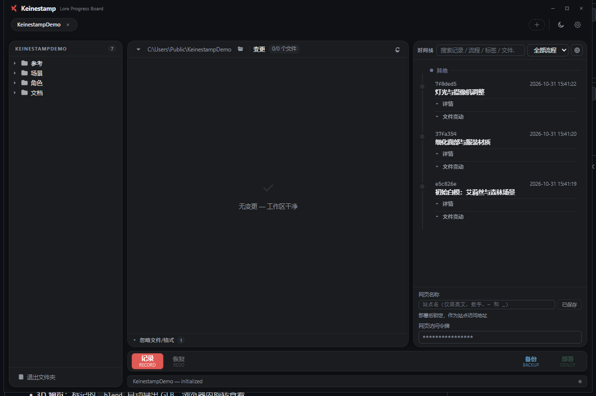
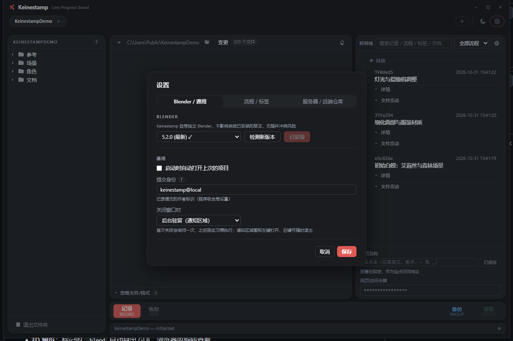

# Keinestamp

**English** | [简体中文](README.zh-CN.md)

**A progress board for binary-heavy projects** (currently optimized for Blender) — local-first
record / rollback / LAN backup / web-timeline deployment for `.blend` files, textures, videos,
design sources, game assets and other large-file projects.

The backend is [Epic Games Lore](https://github.com/EpicGames/lore) 0.8.6 (content-addressed,
chunk-deduplicated VCS): saving the same large file repeatedly keeps only one copy — committing a
`.blend` ten times adds < 1% to the repository (99.9% dedup measured).
The GUI (Tauri 2 + Svelte 5) and the CLI share the same backend logic and work fully offline;
backup and web deployment are opt-in.



## Scope

- **General**: record, timeline, rollback/restore, LAN backup and web deployment for any file or
  directory; the web timeline previews images, video posters and 3D (GLB)
- **Built-in previews**: `.blend` → GLB (exported by Blender), `.glb/.gltf` previewed directly;
  PNG/JPG/WebP/TGA/EXR and design sources such as PSD/KRA/Sai (best-effort thumbnails);
  MP4/MOV/WebM first frame (requires ffmpeg installed on the system)
- **Current focus**: Blender workflows + web timeline (GLB previews, Blender version management,
  process / tag grouping)
- **Other project types**: record / rollback / backup / deployment work out of the box; extra
  preview formats can be added through preview providers
  (see [docs/generalization-plan.md](docs/generalization-plan.md), Chinese)

## Features

- **One-click record**: tick changed files → record; supports process categories, tags and 3D
  preview marking
- **Timeline**: search / filter by process, milestones, file changes, compare with the previous
  record
- **Rollback / restore / supersede**: roll back to any record (the workspace falls to its parent
  version and that record's changes are checked out), undo at any time; recording after a rollback
  supersedes the replaced records
- **Deduplicated storage**: Lore chunk dedup; ten saves of a `.blend` add < 1% to the repository
  (99.9% measured)
- **Multi-type previews**: 3D (`.blend` → GLB, `.glb/.gltf` directly), images / design sources,
  video posters — viewable in the web timeline
- **3D preview**: marked `.blend` files are exported to GLB and can be rotated in the browser
- **LAN backup**: `Backup` = `lore push` to loreserver; offline repositories can be migrated
  online in one click
- **Web timeline**: multi-tenant `serve` deploys to your own server; token login, light/dark
  themes, mobile-friendly
- **Blender version management**: list official versions, install, switch the active one

## Quick start (Windows)

| Option | Description |
|---|---|
| Installer | Download `Keinestamp_0.5.2_x64-setup.exe` and install |
| Portable | Download `Keinestamp-0.5.2-windows-x64-portable.zip`, extract anywhere, run `Keinestamp.exe` |

> Portable = `Keinestamp.exe` + a sibling `lore-bin/` folder (`lore.exe`, `loreserver.exe`,
> `LICENSE`). The bundled Lore version is verified at startup and must be `0.8.6`.

1. Launch, click “+ New project” and pick a project directory (a Blender project, or any directory
   you want versioned)
2. Tick the files to include in this record in the **Changes** panel on the left, then click
   **Record** in the top-right
3. Enter a message; optionally choose a process category / tags / whether to generate a preview



See the **[GUI guide](docs/gui-guide.md)** for details.

## CLI

```powershell
keinestamp init <path>                      # initialize a project (Lore repo + ignore rules)
keinestamp record <path> -m "message"       # record (alias: commit)
keinestamp status <path>                    # show uncommitted changes
keinestamp log <path> -n 20                 # timeline (newest first)
keinestamp rollback <path> -e <record-id>   # roll back to the record's parent version
keinestamp restore <path>                   # undo rollback
keinestamp export <path> -e <record-id> -o <dir>
keinestamp push|pull <path>                 # backup / sync with loreserver
keinestamp serve <path> -p 7799             # start the web service (multi-tenant)
keinestamp deploy <path> --server http://<host>:7799 [--deploy-token <token>]
keinestamp config <path> --set identity=you@host
```

Full reference: **[CLI reference](docs/cli.md)**.

## Server deployment (optional)

The web timeline and LAN backup need a server (Windows or Linux; systemd is recommended on Linux):

```bash
keinestamp serve /srv/keinestamp --port 7799
```

`serve` generates `serve.toml` on demand and provides multi-tenant deployment, token login and
an optional built-in loreserver. See the **[server deployment guide](docs/server-guide.md)**.

## Documentation

- [GUI guide](docs/gui-guide.md)
- [CLI reference](docs/cli.md)
- [Server deployment guide](docs/server-guide.md)
- [Lore 0.8.6 command cheat sheet (development, Chinese)](docs/lore-commands.md)

## Building from source

Prerequisites: Windows 10/11, Rust 1.85+ (Edition 2024), Node.js 20+, npm.
The build script downloads and verifies Lore 0.8.6 into `src-tauri/resources/lore-bin/`
(for offline / China-network builds see [AGENTS.md](AGENTS.md), Chinese).

```powershell
cd frontend; npm install
cd src-tauri; cargo tauri build     # installers go to src-tauri/target/release/bundle/
cargo build --release               # CLI: target/release/keinestamp.exe
```

## Architecture

```
GUI (Tauri 2 / Svelte 5) ─┐
                          ├─ lore_project ─ lore_backend (single lore call site) ─ Lore 0.8.6
CLI (clap) ───────────────┘        ├─ timeline (display cache)
                                   ├─ hidden (ignore rules)
                                   └─ html_gen (web timeline)
serve (multi-tenant HTTP) ─ static html_gen output + optional loreserver
```

## License

**MIT** — see [LICENSE](LICENSE).
Bundled **Lore** (`lore.exe` / `loreserver.exe`) is published by Epic Games under the MIT license;
its license ships as `lore-bin/LICENSE` inside release packages.
